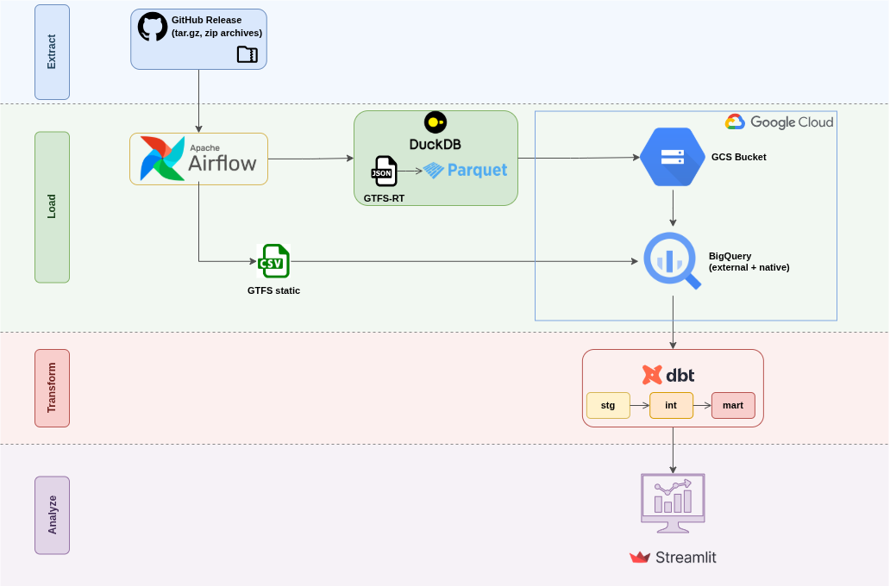
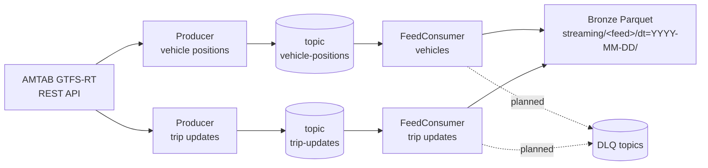
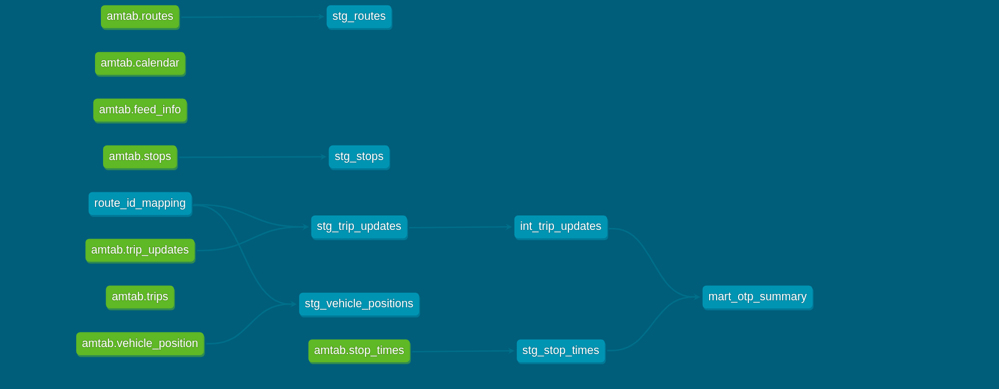
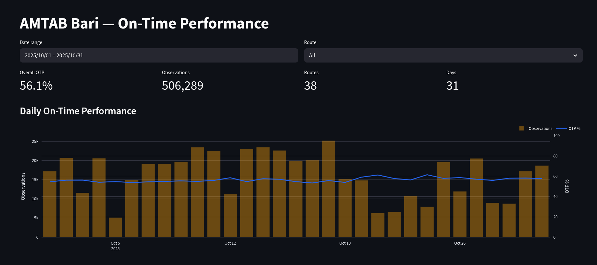
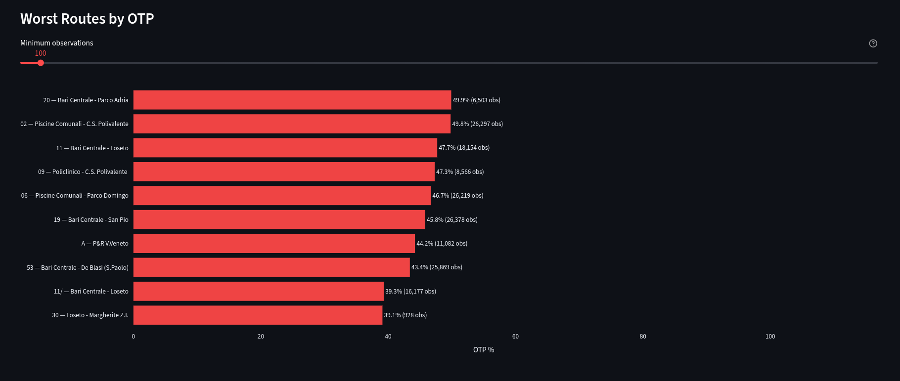

# AMTAB Bari - GTFS ELT Pipeline

## Project Description

[AMTAB](https://www.amtab.it/en) is the public transit company serving Bari,
Italy.

Buses frequently run late or early; therefore, the project goal is to build a
pipeline that ingests transit data provided by AMTAB through their real-time API
based on the [GTFS](http://gtfs.org) specification and compares it against the
published schedule to compute **On-Time Performance (OTP)**, the percentage of
stops served within an acceptable delay window (between -1 and +5 minutes).

The resulting dashboard lets transit planners identify the worst-performing
routes and track OTP trends over time.

This project started as a **batch processing** pipeline: historical data is
ingested, transformed, and loaded on a monthly schedule. A [**streaming
ingestion**](#streaming-ingestion-in-progress) based on Kafka is being added on
top of it.

## Architecture

The pipeline architecture is shown below:



## Streaming Ingestion (in progress)

The streaming path polls AMTAB's live GTFS-RT feeds, publishes every entity to 
Kafka, and lands the raw records in a **Bronze** layer of date-partitioned 
Parquet files. The batch pipeline is unchanged.



The diagram shows the architecture: two topics are fed by two producer
processes and read by two consumers, each in its own consumer group.

The **message key** is `TripId` so all updates for a trip land in the same 
partition and stay ordered. When an entity has no `TripId`, the entity `Id` is 
used as a fallback, and a `valid_key` flag records which key was used. 

For each message, the producer sets the Kafka timestamp to the **event time**: 
the *vehicle timestamp*, or the *feed header timestamp* for *trip updates*.

Consumers write each file **atomically** and **durably**: rows go to a temporary 
file, which is `fsync`ed and then renamed, so readers never see a partial file. 
A UTC timestamp and a random suffix in the name prevent collisions:
`part-<YYYYMMDDTHHMMSSZ>-<id>.parquet`.

### Medallion layers

Both paths follow the medallion architecture:

| Layer | Batch path | Streaming path |
|-------|------------|----------------|
| Bronze | Parquet converted from the JSON archives, on GCS | Raw Kafka records as Parquet, Hive-partitioned by event date |
| Silver | dbt `staging` + `intermediate` (cleaning, typing, deduplication) | Planned: deduplication on `(kafka_partition, kafka_offset)` |
| Gold | dbt `mart` (`mart_otp_summary`) | Shared with batch |

The bronze schema is the following:
 
| Column | Type | Source |
|--------|------|--------|
| `feed` | string | envelope |
| `feed_ts` | timestamp (UTC) | envelope |
| `ingest_ts` | timestamp (UTC) | envelope |
| `valid_key` | bool | envelope |
| `kafka_partition` | int32 | Kafka |
| `kafka_offset` | int64 | Kafka |
| `kafka_key` | string | Kafka |
| `kafka_event_ts` | timestamp ms (UTC) | Kafka |
| `payload` | string (JSON) | the GTFS-RT entity |


### Delivery semantics: at-least-once
 
**Auto-commit is disabled**: the consumer buffers rows, writes them to Parquet, 
and commits offsets only after the write succeeds.

A commit never gets ahead of what is on disk, so *no record is lost*. A crash 
between write and commit replays the last batch, so *duplicates are possible*. 
The Silver layer removes them using `(kafka_partition, kafka_offset)`, which 
identifies a Kafka record uniquely.

### Rebalancing

Each feed has its own consumer group, so a rebalance only happens when a
consumer starts, stops, or is considered dead by the broker. A rebalance on one
feed never pauses the other.

The consumer registers an `on_revoke` callback. `librdkafka` calls it inside
`consume()` or `close()`, on the consumer's own thread, so a revocation never
interrupts a batch halfway through. When partitions are revoked:

1. The buffer is flushed to Parquet.
2. Offsets are committed synchronously, so the next owner starts right after
   the last record written to disk.

If nothing was consumed since the last commit, the commit is skipped.

The callback behaves differently after a failure. If an exception has already
stopped the consumer (for example a failed Parquet write), a `failed` flag is
set before `close()` triggers the revocation, and the callback skips both
the flush and the commit. Committing at that point would move the offsets past
records that were never written.

If the consumer loses its group membership (session timeout, or too long
between two `consume()` calls), the next commit fails with `UNKNOWN_MEMBER_ID`
or `ILLEGAL_GENERATION`. The consumer stops without retrying: those partitions
already belong to another member, which replays the uncommitted records. The
result is duplicates, never data loss.

### Dead-letter queue (in progress)

Some messages can never be processed, however many times they are retried:
invalid JSON, an envelope that fails validation, a missing key, an impossible
timestamp. Stopping the consumer for one of these would block the whole
partition, so they will be published to a per-feed DLQ topic instead:

- the original key and value, unchanged;
- headers with the error message, the source topic, partition and offset, and
  the failure time.

Only per-message problems go to the DLQ. Infrastructure failures (a write or
commit error) and configuration errors (a topic using `LogAppendTime`) stop the
consumer instead, because every following message would fail the same way.

A message sent to the DLQ counts as processed, so its offset is committed with
the next batch, but only after the DLQ producer has flushed and confirmed
delivery. If delivery fails, the consumer stops without committing.

Planned next: a circuit breaker that stops the consumer when the share of
messages going to the DLQ exceeds a threshold, since that usually means a
broken producer rather than a few bad messages.
 
### Failure handling
 
The consumer doesn't try to heal itself: on any unexpected error it stops 
*without committing* and lets a supervisor restart it (Docker restart policy).

On restart it resumes from the last committed offset. Kafka retention is the
buffer while the problem is being fixed.

The table below shows the failure scenarios and the corresponding behaviour:
 
| Failure | Behaviour |
|---------|-----------|
| Parquet write fails | Stop without committing; the batch is replayed on restart |
| Commit fails, retriable | Retry with backoff (5 attempts), then stop |
| Commit fails, consumer left the group | Stop; the new owner replays the uncommitted records |
| Commit fails, unknown or fatal error | Stop |
| Poison message (bad JSON, schema, key or timestamp) | Logged and skipped. Dead-letter queue in progress |
| Topic uses `LogAppendTime` | `ConfigurationError`: stop, someone must fix the topic |
| Fatal Kafka client error | Stop |
 

### Running the tests

The streaming code lives in `streaming/`. 

Unit tests cover parsing and validation, the buffer, the atomic writer, and the 
consumer's commit and failure paths with a fake Kafka consumer:

```bash
uv run pytest
```

## Dataset

### GTFS-RT (Real-Time)

Historical GTFS-RT snapshots were collected from AMTAB's real-time feed at
~30-second intervals. The collection script was run at specific periods of the
day, so the dataset doesn't cover the full 24-hour service window.

The GTFS-RT specification has two entity types:

- **TripUpdate** which stores delay information per trip and stop
(arrival/departure delay in minutes)
- **VehiclePosition** which stores the GPS coordinates, speed, and current stop
for each active bus.

The dataset covers the period from June 2025 to March 2026. This project uses
October to December 2025.

Data is stored as Hive-partitioned JSON files (format `dt=YYYY-MM-DD/hour=HH/`)
and distributed as monthly tar.gz archives via GitHub Releases.

### GTFS Static

The GTFS static archive contains scheduled data from AMTAB: routes, stops,
trips, stop times, calendar, shapes, and feed info.

It is distributed as a zip of CSV files and updated annually in December.

The 2025 archive is used to match the real-time data period.

## Pipeline Software Components

| Component | Tool | Purpose |
|-----------|------|---------|
| IaC | Terraform | Provision GCS bucket, BigQuery dataset, service account |
| Orchestration | Airflow 3 | Schedule and monitor pipeline DAGs |
| Data Lake | GCS | Store processed Parquet files |
| Raw Archive | GitHub Releases | Immutable storage for original JSON and static GTFS archives |
| Warehouse | BigQuery | Analytical queries via external and native tables |
| Transformation | dbt | SQL models (staging, intermediate, mart) |
| Data Quality | dbt tests + dbt utils | Not-null, uniqueness, range, and deduplication checks |
| Dashboard | Streamlit | Visualize OTP metrics with Plotly charts |
| Processing | DuckDB | JSON to Parquet conversion inside Airflow tasks |
| Package Management | uv | Python dependency management and virtual environment |

## Setup Instructions

### Prerequisites

- GCP account with billing enabled
- [gcloud CLI](https://cloud.google.com/sdk/docs/install)
- Terraform >= 1.0
- Docker and Docker Compose v2.14+
- Python 3.12+
- [uv](https://docs.astral.sh/uv/)
- make

All commands below run from the project root, except Terraform (step 3)
which runs from the `terraform/` directory.

The `Makefile` defaults to `GCP_PROJECT_ID=amtab-elt` and
`BQ_DATASET=amtab_transit`. Override them if your project differs:

```bash
make dbt GCP_PROJECT_ID=my-project BQ_DATASET=my_dataset
```

### 1. Initial setup

Clone the repository and install Python dependencies:

```bash
git clone https://github.com/mikiab/amtab-elt.git
cd amtab-elt
make setup
```

### 2. GCP project setup

Create a GCP project and enable the required APIs:

```bash
gcloud projects create <your-project-id>
gcloud config set project <your-project-id>

gcloud services enable \
  bigquery.googleapis.com \
  storage.googleapis.com \
  iam.googleapis.com
```

Authenticate Terraform with your GCP account:

```bash
gcloud auth application-default login
```

### 3. Terraform

Terraform provisions the GCS bucket, BigQuery dataset, service account, and SA
key.

```bash
cd terraform
cp terraform.tfvars.example terraform.tfvars
# Edit terraform.tfvars with your GCP project ID
terraform init
terraform apply
cd ..
```

The SA key is written to `keys/sa-key.json`.

**NOTE:** The files in the `keys` folder are git ignored for security reasons.

### 4. Airflow

Airflow is used to orchestrate the pipeline and it's executed locally via
Docker Compose.

```bash
cp airflow/.env.example airflow/.env
```

Edit `airflow/.env` with your values:

| Variable | Description |
|----------|-------------|
| `AIRFLOW_UID` | Host user ID for bind mount permissions (run `id -u`) |
| `GCS_PROCESSED_BUCKET` | GCS bucket name from Terraform output |
| `GITHUB_RELEASE_URL` | GitHub Release download URL (e.g. `https://github.com/mikiab/amtab-elt/releases/download/v0.1-data`) |
| `BQ_DATASET` | BigQuery dataset name (default: `amtab_transit`) |

```bash
make airflow-up
```

Airflow provides a web UI available at `http://localhost:8080` to launch and
monitor DAGs (username: `airflow`, password: `airflow`).

> **Security note:** This Airflow setup uses hardcoded JWT secrets, default
> credentials, no TLS, and grants admin privileges to all users. This is
> acceptable for a local development environment but **must not** be used in
> production. A production deployment would require secret management (e.g. GCP
> Secret Manager), TLS termination, and role-based access control.

### 5. Run DAGs

In the Airflow UI, perform the following actions:

- **Enable `ingest_and_convert`**. Backfills automatically for Oct-Dec 2025.
  Downloads GTFS-RT archives from GitHub, converts JSON to Parquet via DuckDB,
  and uploads to GCS.
- **Trigger `create_external_tables`**. Creates BigQuery external tables
  pointing to the Parquet files in GCS. Run once.
- **Trigger `load_gtfs_static`**. Downloads the GTFS static archive from
  GitHub, extracts and loads CSVs into BigQuery. Accepts a `year` parameter
  (default: 2025). Run once.

### 6. dbt

```bash
make dbt
```

To browse the documentation and lineage graph:

```bash
make dbt-docs
```

### 7. Dashboard

```bash
make dashboard
```

## dbt Lineage



## Data Quality

The project ensures **data quality** in all models at different layers: staging,
intermediate and mart.

The checks for the *staging* models include:
- Not null keys,
- Accepted values for the delay, latitude, longitude and speed columns,
- Warning message in the case of *duplicates*,
- Route ID normalization via a **seed mapping** (`route_id_mapping.csv`) to
  align real-time and static identifiers.

The checks for the *intermediate* models include:
- **Deduplications** to allow only one observation per trip/stop/day,
- Filtering trips with null delay,
- **Uniqueness** on composite key.

The checks for the *mart* model include:
- **Uniqueness** on composite key.

## Partitioning & Clustering

The `mart_otp_summary` table is **partitioned by date** and **clustered by
route**.

The dashboard's primary interaction is a date range picker. Partitioning by date
means BigQuery only scans the date range the user selected, not the entire table.

With some months of daily data across multiple routes, this reduces query costs
and latency.

Furthermore, within a date partition, the most common filter is by **route**.
**Clustering** physically co-locates rows for the same route, so queries that
filter by route read fewer bytes and the Streamlit dashboard benefits from this.

The BigQuery mart table uses an **incremental strategy** to overwrite the entire
partitions on each dbt run, preventing duplicates without row-level merging.

## BigQuery Table Strategy

Real-time data (TripUpdate, VehiclePosition) is stored as Parquet on GCS and
exposed via **external tables**. External tables avoid data duplication: dbt
reads from GCS directly. Since only dbt queries these tables (not the
dashboard), the lack of caching is acceptable.

Static GTFS data (routes, stops, stop_times, etc.) is loaded as **native
tables**. These are small, rarely change, and benefit from BigQuery's columnar
storage and caching.

## Dashboard

The dashboard queries `mart_otp_summary` in BigQuery and provides two tiles
filterable by date range and route.





## License

BSD-2-Clause. See [LICENSE](LICENSE).
